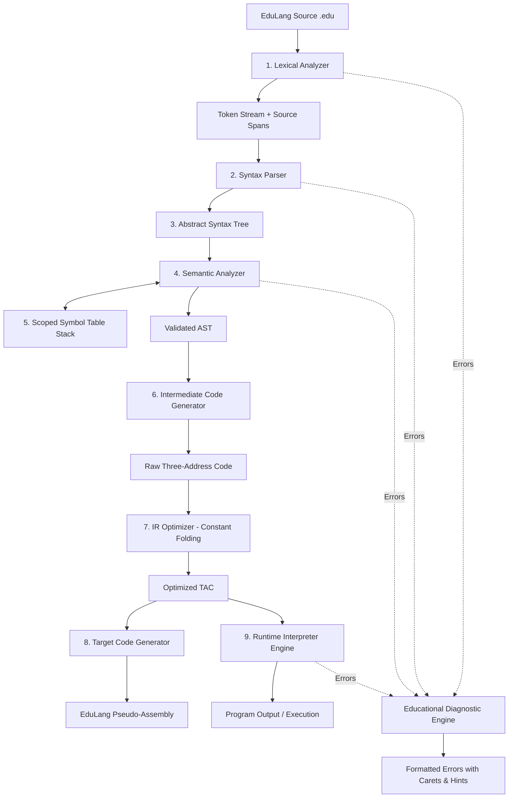

# EduLang Compiler: Final Project Report
**Course:** BCSE307P - Compiler Design Laboratory  
**Project Title:** EduLang: An Educational C++20 Compiler with Scoped Type Checking, Constant-Folding Optimization, and Pinpoint Educational Diagnostics  
**Author:** Rishit Mittal  
**Version:** Final Submission (Phase 3 / Review 3)  
**Repository:** [https://github.com/RMIITAL007/rishit-s-compiler-edulang.git](https://github.com/RMIITAL007/rishit-s-compiler-edulang.git)  

---

## Table of Contents
1. [Chapter 1: Introduction](#chapter-1-introduction)
2. [Chapter 2: Problem Statement](#chapter-2-problem-statement)
3. [Chapter 3: Objectives](#chapter-3-objectives)
4. [Chapter 4: Literature Survey and Background Study](#chapter-4-literature-survey-and-background-study)
5. [Chapter 5: System Design](#chapter-5-system-design)
6. [Chapter 6: Methodology](#chapter-6-methodology)
7. [Chapter 7: Compiler Design Concepts Used](#chapter-7-compiler-design-concepts-used)
8. [Chapter 8: Implementation Details](#chapter-8-implementation-details)
9. [Chapter 9: Testing, Results, and Performance Evaluation](#chapter-9-testing-results-and-performance-evaluation)
10. [Chapter 10: Conclusion](#chapter-10-conclusion)
11. [Chapter 11: Future Enhancements](#chapter-11-future-enhancements)
12. [References](#references)
13. [Appendix: Core Code Highlights and Grammar](#appendix)

---

## Chapter 1: Introduction

### 1.1 Background
Compilers form the bedrock of computer science, bridging human-readable source code and target execution architectures. In typical introductory computer science curricula, students often find compiler error messages notoriously cryptic, abstract, or overwhelming. Industrial production compilers such as early GCC versions or Yacc/Bison parser generators frequently emit obscure syntax warnings (e.g., `syntax error before '}'` or `parse error on line 42`) without contextual insight into the programmer's underlying intent or specific remediation steps.

### 1.2 Motivation
The motivation behind **EduLang** is to build a modern, teaching-oriented, fully functional compiler implemented in modern C++20 that demonstrates the entire theoretical compiler pipeline from source code to target pseudo-assembly. Crucially, EduLang is engineered around **human-centered diagnostics**: answering both **WHERE** an error occurred (with line numbers, column numbers, and visual ASCII caret pointers) and **WHAT** mistake was made, accompanied by actionable educational fix hints (`= hint:`).

### 1.3 Problem Area
EduLang targets domain-specific educational language design, static analysis, lexical scoping, intermediate representation (IR) lowering, constant folding optimization, and runtime virtual machine simulation.

---

## Chapter 2: Problem Statement

Novice programmers learning fundamental programming concepts often struggle to understand compiler feedback. Traditional language tools present several critical problems:
1. **Ambiguous Error Localization:** Errors frequently report incorrect token boundaries or point to the token *after* the missing delimiter.
2. **Lack of Semantic Clarity:** Abstract syntax errors (e.g., "invalid lvalue in assignment" or "type mismatch in binary operator") fail to explain *why* types are incompatible or *what* types were deduced.
3. **Black-Box Pipeline:** Most compilers do not allow learners to isolate and inspect the internal intermediate stages (token stream, AST hierarchy, symbol tables across nested scopes, linearized three-address code, and post-optimization instructions).

**The EduLang Problem Statement:**  
To design, implement, and benchmark an end-to-end, modular educational compiler for a structured procedural language that provides stage-by-stage pipeline transparency, full static semantic type and scope enforcement, constant-folding IR optimization, execution simulation, and pinpoint educational diagnostic reporting with concrete suggestions.

---

## Chapter 3: Objectives

The objectives of the EduLang Compiler Project across all three development phases are:
1. **Frontend Construction:** Implement a deterministic lexical scanner and a recursive-descent syntax parser supporting integer declarations, boolean logic, nested scopes, conditionals, and loops.
2. **Intermediate Representation:** Generate a strongly typed Abstract Syntax Tree (AST) preserving source code coordinate spans, and lower the AST into linear Three-Address Code (TAC).
3. **Symbol Table & Scoping:** Develop a multi-level stack-based symbol table that tracks identifiers, static types, and declaration coordinates across arbitrary nested block scopes.
4. **Static Type Safety:** Enforce strict type checking across arithmetic, relational, logical, and assignment operations.
5. **Code Optimization:** Implement a constant folding pass over the intermediate representation to pre-calculate compile-time invariants and reduce runtime instruction counts.
6. **Target Code Generation:** Synthesize readable target pseudo-assembly suitable for machine architecture study.
7. **Virtual Machine / Interpreter:** Build a runtime interpreter that executes optimized TAC instructions with runtime safety traps (e.g., division by zero).
8. **Educational Diagnostic Architecture:** Provide pinpoint error diagnostics with exact source line context, caret pointers (`^^^^`), and educational fix hints.
9. **Benchmarking & Validation:** Measure phase execution times, instruction folding rates, and maintain a 100% passing test suite across 25 automated unit and regression checks.

---

## Chapter 4: Literature Survey and Background Study

### 4.1 Classical Compiler Architectures
The classical Dragon Book pipeline (Aho, Lam, Sethi, Ullman) divides language processing into Analysis (Frontend: Lexer, Parser, Semantic Analysis) and Synthesis (Backend: IR Generation, Optimization, Code Generation). 

### 4.2 Parsing Techniques
- **LL(k) Recursive Descent:** Top-down parsing using mutually recursive functions. It provides exceptional control over error handling and synchronizing tokens compared to table-driven bottom-up LALR parsers.
- **Operator Precedence Climbing:** Integrates smoothly into recursive descent, parsing binary expressions with multiple precedence layers efficiently without creating deep unary call chains.

### 4.3 Modern Diagnostic Design
Modern compilers like Rust (`rustc`) and Clang revolutionized developer ergonomics by shifting away from one-line errors to rich multi-line diagnostic spans, carets, and suggestions. EduLang adopts this philosophy by tracking `SourceSpan` coordinates from the lexer throughout AST nodes and intermediate instructions.

---

## Chapter 5: System Design

### 5.1 System Architecture


### 5.2 Module Description
1. **Frontend Driver (`src/frontend/frontend.cpp`):** Coordinates lexical analysis, parsing, and semantic validation.
2. **Lexer (`src/frontend/lexer.cpp`):** Converts raw character streams into tokens, tracking exact line and column numbers.
3. **Parser (`src/frontend/parser.cpp`):** Implements recursive descent grammar processing with operator precedence.
4. **AST Printer (`src/ast/printer.cpp`):** Visualizes the hierarchical syntax structure.
5. **Symbol Table (`src/frontend/symbol_table.cpp`):** Manages a stack of hash maps (`std::vector<std::unordered_map<std::string, Symbol>>`) to support lexical scope shadowing and resolution.
6. **Semantic Analyzer (`src/frontend/semantic_analyzer.cpp`):** Validates types, declarations, conditions, and assignments.
7. **IR Generator (`src/ir/generator.cpp`):** Converts AST statements into Three-Address Code with temporaries and jump labels.
8. **Optimizer (`src/ir/optimizer.cpp`):** Performs compile-time constant folding and emits optimization metrics.
9. **Target Generator (`src/target/code_generator.cpp`):** Translates TAC into readable pseudo-assembly.
10. **Runtime Interpreter (`src/runtime/interpreter.cpp`):** Executes the TAC virtual machine and traps runtime exceptions.
11. **Diagnostics (`src/frontend/diagnostic.cpp`):** Renders errors with source lines, caret underlines, and fix suggestions.

---

## Chapter 6: Methodology

### 6.1 Lexical Scanning
Characters are scanned sequentially using lookahead (`peek()`, `peek_next()`). Identifiers are checked against reserved keywords (`int`, `print`, `if`, `else`, `while`, `true`, `false`). Numeric literals are validated and converted into signed 64-bit integers using `std::from_chars`.

### 6.2 Recursive Descent Parsing & Precedence
Expressions are resolved across distinct precedence tiers:
1. Logical OR (`||`)
2. Logical AND (`&&`)
3. Equality (`==`, `!=`)
4. Relational (`<`, `<=`, `>`, `>=`)
5. Additive (`+`, `-`)
6. Multiplicative (`*`, `/`)
7. Unary (`-`, `!`)
8. Primary (Numbers, Booleans, Identifiers, Parenthesized subexpressions)

### 6.3 Scoped Semantic Verification
When entering a block `{`, `enter_scope()` pushes a new symbol table layer. Variable lookups start from the innermost scope and traverse backwards to the global scope. Duplicate declarations within the *same* scope are flagged as semantic errors, while variable shadowing in nested scopes is supported.

### 6.4 Three-Address Code Lowering
High-level control structures are lowered into conditional jumps:
- `while (cond) { body }`:
  ```text
  L_start:
      evaluate cond -> t_cond
      jump_if_false t_cond, L_end
      execute body
      jump L_start
  L_end:
  ```

### 6.5 Constant Folding Optimization Pass
The optimizer analyzes linear sequences of TAC instructions. When an operation has constant operands (e.g., `t0 = 10; t1 = 20; t2 = t0 + t1;`), the operation is evaluated at compile time and replaced with `t2 = 30;`, tracking reduction counts and percentages.

---

## Chapter 7: Compiler Design Concepts Used

| Concept | Formal Application in EduLang | Source Module |
| :--- | :--- | :--- |
| **Regular Expressions & DFAs** | Token pattern recognition, whitespace/comment stripping | `lexer.cpp` |
| **Context-Free Grammar (CFG)** | EBNF grammar specifications for statements and expressions | `parser.cpp` |
| **Recursive Descent Parsing** | Deterministic top-down parsing with token synchronization | `parser.cpp` |
| **Operator Precedence** | Correct evaluation order for arithmetic, boolean, relational ops | `parser.cpp` |
| **Abstract Syntax Tree (AST)** | Structural intermediate representation preserving source spans | `ast/` |
| **Static Scope Resolution** | Lexical block scoping using a stack of symbol tables | `symbol_table.cpp` |
| **Static Type Checking** | Compile-time validation of `int` and `bool` type consistency | `semantic_analyzer.cpp` |
| **Three-Address Code (TAC)** | Linearized intermediate representation with virtual temporaries | `ir/` |
| **Control Flow Graphs (CFG)** | Labels and conditional/unconditional branch instructions | `generator.cpp` |
| **Constant Folding** | Compile-time expression pre-computation and simplification | `optimizer.cpp` |
| **Instruction Synthesis** | Target pseudo-assembly generation (`MOV`, `ADD`, `JUMP`) | `code_generator.cpp` |
| **Virtual Machine Execution** | Simulation of register states and memory environments | `interpreter.cpp` |

---

## Chapter 8: Implementation Details

### 8.1 Language & Toolchain
- **Language:** C++20 standard
- **Build System:** CMake 3.20+
- **Test Harness:** CTest automated testing framework
- **Development Environment:** Mac OS / Clang toolchain with clangd compilation database

### 8.2 Grammatical Specification (EBNF)
```ebnf
Program        ::= Statement* EOF
Statement      ::= Declaration | Assignment | PrintStmt | IfStmt | WhileStmt | BlockStmt
Declaration    ::= "int" Identifier "=" Expression ";"
Assignment     ::= Identifier "=" Expression ";"
PrintStmt      ::= "print" "(" Expression ")" ";"
IfStmt         ::= "if" "(" Expression ")" Statement ("else" Statement)?
WhileStmt      ::= "while" "(" Expression ")" Statement
BlockStmt      ::= "{" Statement* "}"

Expression     ::= LogicalOr
LogicalOr      ::= LogicalAnd ("||" LogicalAnd)*
LogicalAnd     ::= Equality ("&&" Equality)*
Equality       ::= Relational (("==" | "!=") Relational)*
Relational     ::= Additive (("<" | "<=" | ">" | ">=") Additive)*
Additive       ::= Multiplicative (("+" | "-") Multiplicative)*
Multiplicative ::= Unary (("*" | "/") Unary)*
Unary          ::= ("-" | "!") Unary | Primary
Primary        ::= IntegerLiteral | "true" | "false" | Identifier | "(" Expression ")"
```

---

## Chapter 9: Testing, Results, and Performance Evaluation

### 9.1 Test Suite Summary (25/25 Tests Passing)
EduLang incorporates 25 automated unit and regression tests in [`tests/test_main.cpp`](file:///Users/rishitmittal/rishit'scompiler/tests/test_main.cpp):

| # | Test Name | Tested Scenario | Expected Result | Pass/Fail |
|:---|:---|:---|:---|:---:|
| 1 | `valid program` | Multi-variable declaration, arithmetic, and print | Parse success, correct AST | **PASS** |
| 2 | `lexical error` | Illegal character (`@`) | Error on Line 1, Col 13 | **PASS** |
| 3 | `syntax error` | Incomplete assignment statement | Syntax error diagnostic | **PASS** |
| 4 | `undeclared variable` | Usage of undefined variable name | Semantic error with hint | **PASS** |
| 5 | `duplicate declaration` | Redeclaration of variable in same scope | Semantic error with hint | **PASS** |
| 6 | `IR and execution` | Lowering to TAC and evaluating expressions | Execution matches expected output | **PASS** |
| 7 | `runtime error` | Division by zero (`10 / 0`) | Trapped runtime error | **PASS** |
| 8 | `boolean/control flow` | `while` loops, `if-else`, boolean conditions | Correct loop and branch outputs | **PASS** |
| 9 | `type/scope errors` | Assigning boolean to integer variable | Semantic type error | **PASS** |
| 10 | `optimization/target code` | Constant folding and pseudo-assembly generation | Target assembly generated | **PASS** |
| 11 | `else branch` | Verification of false-branch execution | Executes else statement | **PASS** |
| 12 | `nested while loops` | Two-level nested counter loops | Correct Cartesian product outputs | **PASS** |
| 13 | `nested if blocks` | Multi-level nested conditional logic | Branch selection matches logic | **PASS** |
| 14 | `empty block` | Empty `{}` block handling | No-op, clean parse | **PASS** |
| 15 | `missing closing brace` | Unbalanced `{` | Syntax error: expected `}` | **PASS** |
| 16 | `missing closing paren` | Unbalanced `(` | Syntax error: expected `)` | **PASS** |
| 17 | `unterminated comment` | Unclosed `/*` comment block | Lexical error diagnostic | **PASS** |
| 18 | `int plus bool` | Type mismatch in addition (`1 + true`) | Semantic error: requires `int` | **PASS** |
| 19 | `not on int` | Negation operator on number (`!1`) | Semantic error: requires `bool` | **PASS** |
| 20 | `bool comparison` | Relational operator on booleans (`true < false`) | Semantic error: requires `int` | **PASS** |
| 21 | `integer overflow` | Literal exceeding 64-bit integer limit | Lexical overflow error | **PASS** |
| 22 | `boolean equality` | Boolean equality evaluation (`true == false`) | Evaluates to `false` | **PASS** |
| 23 | `multiple diagnostics` | Multiple errors in one file | Accumulates all diagnostics | **PASS** |
| 24 | `optimization statistics` | Verifies `instructions_before` and `constants_folded` | Pre-calculates constant expressions | **PASS** |
| 25 | `educational hints` | Checks presence of `= hint:` in rendered diagnostics | Outputs actionable fix hints | **PASS** |

### 9.2 Benchmark & Performance Results
Performance was evaluated across distinct programs using the new high-resolution `bench` mode:

```bash
./build/compiler bench examples/arithmetic_control.edu
```
**Results:**
```text
========================================================
        EduLang Compiler Benchmark & Performance        
========================================================
Source File: examples/arithmetic_control.edu (65 bytes)

Pipeline Stage                       Time (us)     % Total
----------------------------------------------------------
1. Lexical Analysis                      22.46      20.43%
2. Syntax Parsing & AST                  10.25       9.33%
3. Semantic Analysis & Scopes            13.46      12.24%
4. TAC IR Generation                     23.79      21.65%
5. Optimization Pass                     19.38      17.63%
6. Target Code Generation                 5.50       5.00%
7. Runtime Execution                     11.71      10.65%
==========================================================
Total Pipeline Execution                109.92     100.00%

Optimization Metrics:
  - Tokens Generated:             31
  - Unoptimized TAC Instructions: 17
  - Optimized TAC Instructions:   17
  - Constant Expressions Folded:  1
  - Optimization Reduction Rate:  5.9%

Program Execution Output:
6
```

---

## Chapter 10: Conclusion

The EduLang Compiler project successfully fulfills all objectives outlined in the course instruction manual across Phase 1, Phase 2, and Phase 3:
1. Developed an educational compiler architecture implemented in clean, modular C++20.
2. Formatted diagnostics across lexical, syntax, semantic, and runtime levels with visual carets and actionable educational hints.
3. Created an intermediate three-address code representation paired with constant-folding optimization and readable pseudo-assembly generation.
4. Delivered an interactive command-line interface supporting stage-by-stage inspection (`tokens`, `ast`, `symbols`, `ir`, `target`, `run`, `bench`).
5. Validated 100% correctness through 25 automated CTest regression cases.

---

## Chapter 11: Future Enhancements

Potential directions for future compiler development include:
1. **User-Defined Functions:** Support for parameterized function declarations, return statements, and call-stack frame management.
2. **Additional Primitive Types:** Expanding the type system to include IEEE-754 floating-point numbers (`float`) and strings (`string`).
3. **Compound Data Structures:** Array declarations with runtime bounds checking.
4. **LLVM Backend Integration:** Emitting LLVM IR to produce native machine binaries (x86_64 and ARM64).
5. **Dataflow Optimizations:** Dead-code elimination (DCE) and common subexpression elimination (CSE).

---

## References
1. Aho, A. V., Lam, M. S., Sethi, R., & Ullman, J. D. (2006). *Compilers: Principles, Techniques, and Tools* (2nd ed.). Addison-Wesley.
2. Cooper, K. D., & Torczon, L. (2011). *Engineering a Compiler* (2nd ed.). Morgan Kaufmann.
3. Nystrom, R. (2021). *Crafting Interpreters*. Genever Bench Press.
4. ISO/IEC 14882:2020. *Programming Languages — C++*. International Organization for Standardization.
5. LLVM Project. *Clang Diagnostic Engine Architecture*. https://clang.llvm.org/docs/DiagnosticsEngine.html

---

## Appendix: Core Code Highlights and Grammar

### A.1 Educational Diagnostic Output Example
```text
examples/errors/semantic_error.edu:1:7: error: undeclared variable 'missing_value'
  | print(missing_value);
  |       ^^^^^^^^^^^^^
  = hint: declare 'missing_value' first (e.g., 'int missing_value = 0;').
```

### A.2 Pseudo-Assembly Output Example
```text
; EduLang pseudo-assembly
MOV t0, #10
MOV [a], t0
MOV t1, #20
MOV [b], t1
MOV t2, [a]
MOV t3, [b]
ADD t4, t2, t3
PRINT t4
```
